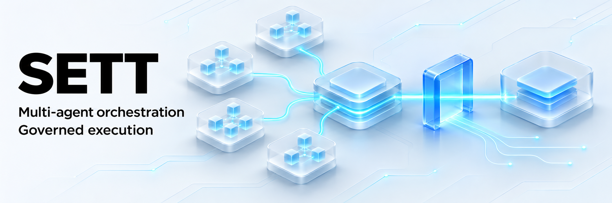
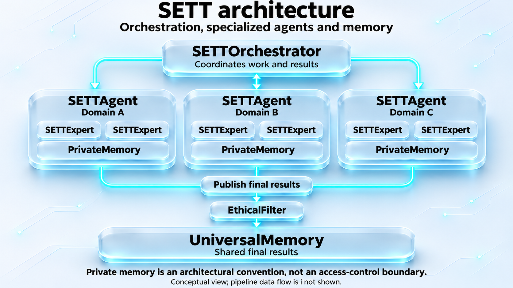

# SETT Framework

**Scalable Expert-based Task Topology**

[](https://github.com/4HumanityAI/sett-framework/actions/workflows/ci.yml)
[](https://www.python.org/downloads/)
[](LICENSE)
[](https://doi.org/10.5281/zenodo.21287133)
[](https://github.com/sponsors/EduDanielV)

[Install](#install) · [Quick start](#quick-start) · [Architecture](#sett-architecture) · [API reference](docs/api_reference.md) · [Limitations](#current-limitations)

SETT is a Python framework for building multi-agent AI systems that stay
auditable. Domain-specialized agents, each made of small single-task experts,
work under one orchestrator. Each agent keeps its own private memory and
shares only final results. Real-world actions are described as data and
submitted to an executor, which runs one only after an ethical filter, and
optionally an authorization check, have approved it.

The language model is a tool inside an expert, not the system itself.

SETT is inspired by the [Badger Architecture](https://arxiv.org/pdf/1912.01513)
(Rosa et al., 2019) and applies its idea of coordinated expert agents at a
**macro scale**: pre-designed, domain-specialized agents under a single
orchestrator, each with independent memory, communicating only final results
through a shared universal memory.

> 📄 **Read the paper:**
> [English](https://doi.org/10.5281/zenodo.21287133) ·
> [Español](https://doi.org/10.5281/zenodo.21287355) ·
> [日本語](https://doi.org/10.5281/zenodo.21301700)

---

## Why SETT?

Many frameworks treat the language model as the system itself. SETT keeps
these concerns apart:

- **Reasoning**: pre-designed experts, one task each.
- **Communication**: agents publish results; they never call each other directly.
- **Memory**: private per agent; universal only for final results.
- **Execution**: real-world side effects submitted through `SETTExecutor` pass through a single, auditable gate.
- **Authorization**: optional policies that, once configured, every handler must pass.
- **Ethical validation**: a governance layer, not a prompt that can be skipped.

Keeping them apart makes a multi-agent system easier to audit, extend and
secure than one large, opaque agent loop.

---

## Project status

- **Current release: 0.15.0.** It adds a policy layer for authorization:
  declared policy selection, policy identity and origins, conditions checked
  by the application's verifiers, reviews, decision records in a governance
  journal, read-only recovery with explicit continuation, and explanations
  of each decision. Authorization issues a receipt only when every state
  producer is configured; see [Current limitations](#current-limitations).
- **Earlier releases** added opt-in durable storage for evidence and state,
  with recovery after a restart that never resumes pipelines on its own
  (0.14), adapter capabilities and health checks (0.13;
  SETT describes and filters adapters but never chooses a provider for you),
  cancellation, deadlines and idempotency (0.12), and complete causal tracing
  (0.11). The [changelog](CHANGELOG.md) describes every release.

The [API reference](docs/api_reference.md) and the
[security model](docs/security_model.md) state exactly what is and is not
guaranteed.

## Install

Upgrading from v0.14.0? Read the
[migration steps](CHANGELOG.md#migrating-from-v0140) before replacing your
installation, including if you do not use authorization.

SETT is not published on PyPI. Install it from source:

```bash
git clone https://github.com/4HumanityAI/sett-framework.git
cd sett-framework
pip install -e .

# With LLM support
pip install -e ".[anthropic]"   # Claude
pip install -e ".[openai]"      # GPT
pip install -e ".[gemini]"      # Gemini
pip install -e ".[all]"         # All adapters
```

SETT requires Python 3.13 or newer. The supported test matrix targets
Python 3.13, 3.14 and 3.15. Results apply only to the exact source revision
and environments recorded in the release's verification evidence.
The CI badge reports on the public repository, not on unreleased work.

This release was validated on Windows with Python 3.13, 3.14 and 3.15. Linux
and macOS have not been validated for this release.

The `templates/` directory is part of the source tree and the release
archive, not of the installed package: a template is a file you copy and
edit, not a module SETT imports.

> 💡 Want a free, offline, local LLM instead? `OllamaAdapter` needs no
> extra install at all: just [Ollama](https://ollama.com) itself
> running on your machine. See `docs/api_reference.md`.

## Quick start

```python
from sett import SETTOrchestrator, SETTAgent, SETTExpert, EthicalFilter, SETTExecutor

# 1. Define an expert
class MyExpert(SETTExpert):
    def resolve(self, context):
        result = {"answer": f"Processed: {context.get('input')}"}
        if self._private_memory:
            self._private_memory.write("last_input", context.get("input"))
        return result

# 2. Define an agent that submits a real-world side effect as data
class MyAgent(SETTAgent):
    def __init__(self):
        super().__init__(name="MyAgent", domain="my_domain")
        self.register_expert(MyExpert(name="my_expert"))

    def process(self, input_data):
        analysis = self.get_expert("my_expert").resolve(input_data)
        self._publish_to_universal(analysis)

        # Actions as Data: describe intent, don't perform it directly.
        # Submitted through the Executor, the real handler runs only after
        # the EthicalFilter approves it. A side effect that application code
        # performs directly, outside the Executor, is not intercepted.
        result = self.submit_action("send_notification", payload={"msg": analysis["answer"]})
        return {**analysis, **result}

# 3. Define the handler that performs the real side effect
def handle_notification(payload):
    print(f"Real-world side effect executed: {payload.get('msg')}")
    return {"delivered": True}

# 4. Build and wire the system
orchestrator = SETTOrchestrator(ethical_filter=EthicalFilter())
executor = SETTExecutor()
executor.register_handler("send_notification", handle_notification)

orchestrator.register_executor(executor)   # order-independent
orchestrator.register_agent(MyAgent())

# 5. Run: fails closed if the EthicalFilter rejects the action
result = orchestrator.process({"input": "hello"}, domain="my_domain")
print(result)
# Real-world side effect executed: Processed: hello
# {'answer': 'Processed: hello', 'delivered': True}

# 6. Every decision the EthicalFilter makes is logged: nothing happens
#    silently, whether it was allowed, warned, or rejected.
for entry in orchestrator.get_ethical_audit_log():
    print(f"[{entry['verdict'].upper()}] {entry['action']}: score: {entry['harm_score']:.2f}")
# [ALLOW] memory_write: score: 0.50
# [ALLOW] send_notification: score: 1.50
```

This is the basic path: experts, agents, memory, the ethical filter and the
executor, without policy authorization.

### A governed action

Version 0.15 adds a policy layer in front of authorization.
[`examples/governed_action.py`](examples/governed_action.py) governs one
action with it: the application's policy grants a refund on condition that
the customer is verified, the application's verifier checks that condition,
and every state producer that authorization needs is configured explicitly.

Install SETT first (see [Install](#install)); the examples import the
installed package.

```bash
python -B examples/governed_action.py
```

Three attempts follow. The first is granted and its handler runs once; the
second is blocked because the declared condition is not met, and the third
because the policy denies it:

```text
SETT 0.15.0: one governed action, every state producer configured
  refund of 40, customer verified      refunded
  refund of 40, customer not verified  blocked: authorization.condition_unsatisfied
  refund of 250, customer verified     blocked: authorization.denied
Handler runs: 1
Decision records: grant, deny
Grant, for operators: condition example.customer_verified satisfied
Blocked attempt, for the public: authorization.condition_unsatisfied, 2 values withheld
```

The example keeps its parts small on purpose: its verifier reads a flag from
the request instead of the application's identity records, its governance
journal is kept in memory, and its handler only appends to a list. A
deployment supplies its own verifier, a journal stream with the durability
it requires, and its real client. See [the policy layer](docs/policy_ruler.md),
[the governance journal](docs/governance_journal.md) and
[explanations](docs/explanations.md).

## Key features

- ✔ Expert-based multi-agent architecture
- ✔ Independent private memory per agent
- ✔ Universal shared memory for final results only
- ✔ Actions as Data: a side effect is described first and runs only after approval
- ✔ Ethical governance of submitted actions and memory writes
- ✔ Fail-closed execution: with no executor, no filter, no handler, or a rejection, nothing runs
- ✔ Defensive snapshots of shared memory and the audit log, with verifiable hash chains
- ✔ Native pipelines: chain agents with explicit, hand-to-hand data flow
- ✔ Cooperative cancellation addressed by the same `run_id` your traces show
- ✔ Deadlines that can only shrink when nested, never extend
- ✔ Structured outcomes that keep a rejection, a timeout and a failure apart
- ✔ Idempotency keys and opt-in retries at the real-world effect boundary
- ✔ Opt-in durable evidence, versioned state and recovery after a restart
- ✔ Copy-on-write migrations with dry runs computed from the stored evidence
- ✔ Swappable LLM adapters (Claude, GPT, Gemini, Ollama)
- ✔ Optional policy layer and Authorization Ruler with receipts and fail-closed enforcement: usable end to end once every required state producer is configured explicitly, and blocking without them; see [Current limitations](#current-limitations)

## Core concepts

| Concept | Description |
|---|---|
| `SETTOrchestrator` | The brain of the system. It coordinates agents and manages universal memory. |
| `SETTAgent` | A domain specialist made of experts. It has its own private memory. |
| `SETTExpert` | The smallest unit. It resolves one specific task. |
| `SETTExecutor` | The one gate for real-world side effects submitted through it (`submit_action()`, `submit()`, `submit_controlled()`). An effect runs only after ethical approval and, when configured, receipt verification. Side effects that application code performs directly, outside `SETTExecutor`, are not intercepted. |
| `Action` | A real-world side effect described as data, not code. |
| `AuthorizationRuler` | An optional, deterministic authority boundary. Once configured, every handler requires a policy grant and a verified receipt from its store. |
| `UniversalMemory` | Shared state. Agents publish only final results here. |
| `PrivateMemory` | Each agent's internal workspace. It is not exposed through the public API, and it is isolated by convention, not by a runtime access-control boundary. |
| `EthicalFilter` | The governance layer. Every action submitted through `SETTExecutor` passes through it before execution. `propose_action()` offers a lighter check that the application must remember to call. |
| `ContextAnalyzer` | Evaluates a proposed action in context. Domain analyzers can return a `SafetyAssessment` that separates urgency, action harm and omission risk. |
| `run_pipeline()` | An orchestrator method that chains registered agents into ordered stages, with explicit, hand-to-hand data flow that never goes through universal memory, and fail-closed handling of rejections. See `docs/api_reference.md`. |

## Current limitations

> **Current limitation.** Authorization issues a receipt only when every
> verified state it requires has a producer, and each producer comes only
> from explicit configuration on `PolicyRuler`: conditions from condition
> verifiers (`condition_verifiers=`, which may be empty), consent from the
> implementation's declaration (`implementation_owned_consent=True`; SETT
> records that declaration and verifies no consent), durability from a
> decision record written to a governance journal (`governance_journal=`),
> and review from the application's review verifiers (`review_verifiers=`,
> which need that journal). Without all four, every `authorize()` call that
> reaches state verification fails with
> `authorization.policy_evaluation_incomplete`, even when every policy would
> grant, and no receipt is issued, so handlers that require an authorization
> receipt cannot run. This is deliberate: the framework blocks rather than
> act on unverified state.
>
> If a policy denied the action during such an attempt, the denial is visible
> only in `SETTAuthorizationError.policy_observations`, with its reason codes
> in `policy_observation_reason_codes`. Attempts that fail earlier keep their
> own reason codes, for example when the request is invalid, an approval
> cannot be verified or a policy fails.

The [security model](docs/security_model.md) lists the other limits,
including what private memory does and does not protect.

Authorization contracts and wiring are documented in
[`docs/api_reference.md`](docs/api_reference.md#authorization_ruler), and
stable failure identifiers in
[`docs/authorization_reason_codes.md`](docs/authorization_reason_codes.md).
Governing a tool loop from another framework adds no dependency in either
direction: see [`docs/foreign_callers.md`](docs/foreign_callers.md).

## Four principles of SETT

**1. Pre-designed experts.** Experts know their domain before the system runs.
They are not trained on the fly; they are built with a purpose.

**2. Independent memory per agent.** Each agent has a private workspace.
Sharing only final results is an architectural convention; `PrivateMemory`
is not a runtime access-control boundary. See [the security model](docs/security_model.md).

**3. Communication by events.** Agents don't call each other directly.
They publish to universal memory, and the orchestrator puts the results together.

**4. The LLM is an engine, not the architecture.** The language model is a
tool inside an expert, not the system itself. Swap Claude for GPT or any
local model by changing the adapter.

## SETT Architecture



Real-world side effects (`submit_action`) follow a separate, fail-closed path:


<details>
<summary>Text-only diagrams</summary>

```
┌─────────────────────────────────────────────────────┐
│                   SETTOrchestrator                  │
│  ┌───────────────────────────────────────────────┐  │
│  │              EthicalFilter (ring)             │  │
│  └───────────────────────────────────────────────┘  │
│  ┌──────────┐  ┌──────────┐  ┌───────────────────┐  │
│  │  Agent A │  │  Agent B │  │     Agent C       │  │
│  │ Expert 1 │  │ Expert 1 │  │    Expert 1       │  │
│  │ Expert 2 │  │ Expert 2 │  │    Expert 2       │  │
│  │[private] │  │[private] │  │   [private]       │  │
│  └────┬─────┘  └────┬─────┘  └────────┬──────────┘  │
│       │             │                 │             │
│  ┌────┴─────────────┴─────────────────┴──────────┐  │
│  │               UniversalMemory                 │  │
│  └───────────────────────────────────────────────┘  │
└─────────────────────────────────────────────────────┘
```

Real-world side effects (`submit_action`) follow a separate, fail-closed path:

```
Agent ──Action──> EthicalFilter ──approved?──> Authorization ──> SETTExecutor ──> real client
                       │                         │
                       └──rejected───────────────┴──> nothing runs (fail closed)
```

</details>

## Sponsors

SETT is free and MIT-licensed for everyone, and stays that way.
[Sponsoring](SPONSORS.md) is a way to help fund maintenance time on the
framework layer itself.

*Nobody yet; you could be the first. See [`SPONSORS.md`](SPONSORS.md)
for tiers.*

## Contributing

This is an independent, solo project: issues, ideas, and pull requests
are welcome. See [`CONTRIBUTING.md`](CONTRIBUTING.md).

## License

MIT License

Copyright (c) 2026 Eduardo Daniel Viñales

Academic inspiration: [BADGER: Learning to (Learn [Learning Algorithms] through Multi-Agent Communication)](https://arxiv.org/pdf/1912.01513), by Marek Rosa et al., GoodAI, 2019
